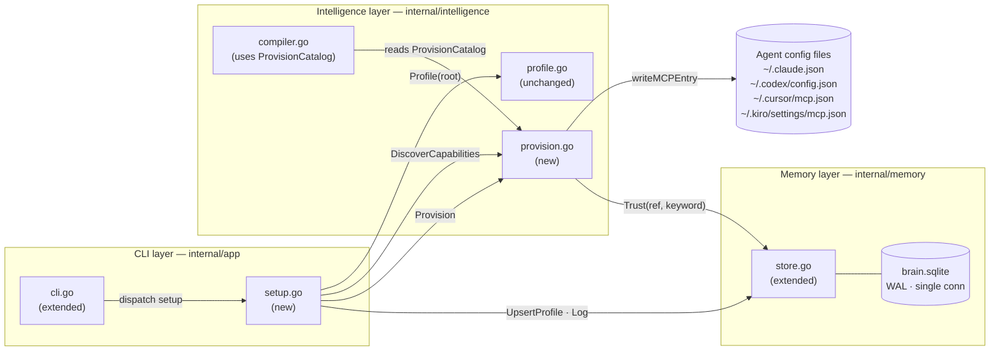

# Design Document: Auto-Project-Setup

## Overview

The auto-project-setup feature extends Noevyra with a `brain setup` command that turns the existing one-shot `intelligence.Profile()` detection into a persistent, provisioning-capable workflow. A single command detects the project type, discovers matching Capabilities from an expanded catalog, lets the user select what to provision, writes MCP server configuration to every detected agent, registers approved skills, and persists the resulting Project_Profile in SQLite so it travels with the developer across all four supported agents.

Alongside the setup command, this feature adds **Kiro** as a fully supported fourth agent in `brain run`, `brain doctor`, and `brain mcp-config`, using the identical context-file mechanism already in place for Claude, Codex, and Cursor.

### Scope at a glance

| Area | Change |
|---|---|
| `internal/app/cli.go` | Add `setup` dispatch; add `kiro` to `run`, `doctor`, error strings |
| `internal/app/setup.go` | **New file** — `brain setup` orchestration |
| `internal/intelligence/provision.go` | **New file** — `ProvisionCatalog`, `DiscoverCapabilities`, `Provision`, `writeMCPEntry` |
| `internal/intelligence/compiler.go` | Replace internal `capability` type with `ProvisionableCapability`; no logic change |
| `internal/memory/store.go` | Schema v3 (`project_profiles` table); `UpsertProfile`, `LatestProfile` methods |

**Nothing else changes.** `intelligence.Profile()`, `intelligence.Compile()`, the MCP protocol adapter, all existing CLI commands, and the scheduler remain untouched.

## Architecture



### Data flow for `brain setup`

```
invocation directory
        │
        ▼  projectRoot(cwd) — walk ≤10 ancestor levels looking for .git
   Project_Root
        │
        ▼  intelligence.Profile(root) — bounded scan ≤4000 files (unchanged)
   ProjectProfile { Languages, Stacks, Signals, Manifests, Counts, Truncated }
        │
        ├──▶  print profile summary to stdout (Req 1.6)
        │
        ▼  store.LatestProfile(project.ID)
   *StoredProfile (nil on first run)
        │
        ├──▶  [existing profile + no --refresh] prompt confirmation; abort on deny
        │
        ▼  intelligence.DiscoverCapabilities(profile, trusted skills)
   []ProvisionableCapability  ≤10, sorted by confidence desc
        │
        ├──▶  [--dry-run] print plan, return
        │
        ▼  promptSelection(in, out, caps) — numbered list; "1,3" / "all" / "none"
   []ProvisionableCapability (selected subset)
        │
        ▼  for each cap: intelligence.Provision(cap, agentPaths, store, dryRun, in, out)
   []ProvisionResult { Outcome: provisioned | skipped | failed }
        │
        ├──▶  printProvisionSummary(out, results)
        │
        ▼  store.UpsertProfile(project.ID, root, profileJSON, capabilitiesJSON)
        │
        ▼  store.Log("setup_session", project.ID, sessionEvent)
```

## Components and Interfaces

### `internal/app/setup.go` (new file)

```go
// projectRoot walks ancestor directories from cwd looking for a .git folder.
// It checks cwd first then up to 10 parent directories. Returns cwd unchanged
// if no .git is found within that bound (Req 1.1, 1.7).
func projectRoot(cwd string) string

// runSetup is the handler for the "brain setup" CLI command.
// Recognised flags: --refresh (skip overwrite prompt),
//                   --dry-run (print plan, write nothing),
//                   --status (display stored profile, exit).
func runSetup(
    store   *memory.Store,
    project memory.Project,
    args    []string,
    in      io.Reader,
    out     io.Writer,
    errOut  io.Writer,
    home    string,
) error
```

Internal helpers in `setup.go` (all unexported):

| Function | Purpose |
|---|---|
| `displayProfile(out, profile)` | Print detected languages / stacks / signals in human-readable form |
| `promptConfirm(in, out, msg) (bool, error)` | Read a `y/N` answer from `in` |
| `promptSelection(in, out, caps) ([]ProvisionableCapability, error)` | Print numbered list; parse `"1,3"`, `"all"`, or `"none"` |
| `printProvisionSummary(out, results)` | Aligned table of capability name → outcome |
| `buildSessionEvent(results) map[string]any` | Build the payload for the `setup_session` event log entry |

`runSetup` interprets `--status` as a read-only path: it calls `store.LatestProfile`, formats the stored JSON, and returns without running detection or provisioning.

### `internal/intelligence/provision.go` (new file)

#### Types

```go
// NetworkReq classifies whether provisioning requires outbound network access.
type NetworkReq string

const (
    NetworkLocal   NetworkReq = "local"   // no outbound requests
    NetworkNetwork NetworkReq = "network" // requires internet
)

// MCPServerDef is the MCP server entry written to agent config files.
type MCPServerDef struct {
    Command string   `json:"command"`
    Args    []string `json:"args"`
}

// ProvisionableCapability is the unified type used by both
// brain setup (discovery + provisioning) and brain advise (Compile recommendations).
// It replaces the unexported capability type in compiler.go.
type ProvisionableCapability struct {
    Kind           string        `json:"kind"`            // "mcp" | "skill" | "cli"
    Ref            string        `json:"ref"`             // stable short identifier
    Name           string        `json:"name"`            // human display name
    Reason         string        `json:"reason"`          // one-line reason (used by Compile)
    Description    string        `json:"description"`     // extended description (used by setup)
    Confidence     float64       `json:"confidence"`      // 0.0–1.0 base confidence score
    TriggerSignals []string      `json:"triggerSignals"`  // matched against profile terms
    Network        NetworkReq    `json:"network"`
    MCPServer      *MCPServerDef `json:"mcpServer,omitempty"`    // kind == "mcp"
    SkillKeyword   string        `json:"skillKeyword,omitempty"` // kind == "skill"
    CLIBinary      string        `json:"cliBinary,omitempty"`    // kind == "cli"
}

// ProvisionOutcome classifies the result of a single Provision call.
type ProvisionOutcome string

const (
    OutcomeProvisioned ProvisionOutcome = "provisioned"
    OutcomeSkipped     ProvisionOutcome = "skipped"
    OutcomeFailed      ProvisionOutcome = "failed"
)

// ProvisionResult records the outcome of one Provision call.
type ProvisionResult struct {
    Capability ProvisionableCapability `json:"capability"`
    Outcome    ProvisionOutcome        `json:"outcome"`
    Error      string                  `json:"error,omitempty"`
}

// AgentConfigPaths maps each supported agent name to its MCP config file path.
type AgentConfigPaths struct {
    Paths map[string]string // e.g. "kiro" → "/Users/alice/.kiro/settings/mcp.json"
}
```

#### Exported functions

```go
// ProvisionCatalog is the authoritative ordered list of provisionable capabilities.
// It is also read by compiler.go for context-pack recommendations, replacing the
// previous unexported capability slice.
// The catalog guarantees at least one entry per required signal:
//   go · rust · python · typescript · javascript · database ·
//   web · api · security · containers · ci-cd
var ProvisionCatalog []ProvisionableCapability

// DefaultAgentConfigPaths returns the platform-standard MCP config file paths
// for all four supported agents, with ~ expanded via os.UserHomeDir.
func DefaultAgentConfigPaths() (AgentConfigPaths, error)

// DiscoverCapabilities returns at most 10 ProvisionableCapabilities from
// ProvisionCatalog sorted by confidence descending.
// A catalog entry is included when at least one of its TriggerSignals matches—
// by case-insensitive exact comparison—any term in the union of
// profile.Languages, profile.Stacks, and profile.Signals.
// Trusted skills from approved_skills that match on keyword are appended with
// confidence 0.95 and tagged as Trusted before the cap of 10 is applied (Req 3.1, 3.3, 3.6).
func DiscoverCapabilities(
    profile ProjectProfile,
    trusted []memory.Skill,
) []ProvisionableCapability

// Provision installs or configures a single capability and returns the result.
//
//   kind == "mcp":
//     For each agent whose binary is found via exec.LookPath, calls writeMCPEntry
//     to add or update the server entry in that agent's config file.
//     Outcome is "failed" if no agent is detected (Req 4.9).
//
//   kind == "skill":
//     Prompts the user for per-skill approval (Req 4.2).
//     On approval calls store.Trust(ref, keyword).
//     On denial sets Outcome to "skipped" (Req 4.8).
//
//   kind == "cli":
//     Checks exec.LookPath for CLIBinary.
//     Outcome is "failed" if not found (manual installation required).
//
// When dryRun is true no files or DB records are modified (Req 3.4, 4.7).
func Provision(
    cap        ProvisionableCapability,
    agentPaths AgentConfigPaths,
    store      *memory.Store,
    dryRun     bool,
    in         io.Reader,
    out        io.Writer,
) ProvisionResult
```

#### Unexported function

```go
// writeMCPEntry atomically merges entry under serverName into the mcpServers object
// of the JSON file at path, creating the file and any missing parent directories.
// Preserves all other top-level keys. Enforces exactly one entry per serverName
// (idempotent — calling N times yields the same result as calling once) (Req 4.6).
// Uses a write-to-temp-then-rename strategy so partial writes cannot corrupt the file.
func writeMCPEntry(path, serverName string, entry MCPServerDef) error
```

### Changes to `internal/intelligence/compiler.go`

- Remove the unexported `capability` struct.
- Remove the `capabilityCatalog` var.
- In `capabilityRecommendations`, iterate `ProvisionCatalog` and read `item.TriggerSignals`, `item.Kind`, `item.Ref`, `item.Reason` in place of the old unexported fields.
- No change to any exported function (`Compile`, `Feedback`, `Profile`, `PackSummary`, etc.).

### Changes to `internal/app/cli.go`

**1. Add `setup` command:**
```go
// In the allowed map:
"setup": true,

// New dispatch case (before the default):
case "setup":
    return runSetup(store, project, args, in, out, errOut, home)
```

**2. Extend `runAgent` for Kiro:**
```go
binaries := map[string]string{
    "claude":  "claude",
    "codex":   "codex",
    "cursor":  "cursor-agent",
    "kiro":    "kiro",          // new
}
if len(args) == 0 || binaries[args[0]] == "" {
    return errors.New("use brain run claude|codex|cursor|kiro [task]")
}
agent := args[0]
binary := binaries[agent]

// Pre-flight PATH check with agent-specific messaging (Req 6.7):
if _, lookErr := exec.LookPath(binary); lookErr != nil {
    if agent == "kiro" {
        fmt.Fprintln(errOut, "brain: kiro executable not found in PATH; install the Kiro CLI and ensure it is accessible before retrying")
    } else {
        fmt.Fprintf(errOut, "brain: %s not found in PATH\n", binary)
    }
    return lookErr
}
```

The task is passed as the first CLI argument and the `BRAIN_CONTEXT_FILE` environment variable is set — identical to the existing pattern (Req 6.3). The `defer os.RemoveAll(dir)` already handles session-dir cleanup (Req 6.5).

**3. Add `kiro` to `doctor` binary check:**
```go
for _, bin := range []string{"git", "claude", "codex", "cursor-agent", "kiro", "npx"} {
```

**4. `mcpConfig()` is unchanged.** The current output is already Kiro-compatible:
```json
{"mcpServers": {"brain": {"command": "<abs-path>", "args": ["mcp"]}}}
```
Kiro uses standard MCP protocol; no Kiro-specific format deviation is needed (Req 6.6).

### Changes to `internal/memory/store.go`

**New struct:**
```go
// StoredProfile is a persisted Project_Profile row from the project_profiles table.
type StoredProfile struct {
    ID               string `json:"id"`
    ProjectID        string `json:"projectId"`
    Root             string `json:"root"`
    ProfileJSON      string `json:"-"` // raw JSON of intelligence.ProjectProfile
    CapabilitiesJSON string `json:"-"` // raw JSON of []ProvisionResult
    CreatedAt        string `json:"createdAt"`
}
```

**New methods:**
```go
// UpsertProfile persists a new Project_Profile in project_profiles within a single
// transaction. If the count of profiles for projectID is already 3, the oldest by
// created_at is deleted before the insert (Req 2.1, 2.3, 2.8).
func (s *Store) UpsertProfile(
    projectID, root, profileJSON, capabilitiesJSON string,
) (StoredProfile, error)

// LatestProfile returns the most recently created StoredProfile for projectID,
// or (nil, nil) if none exists (Req 2.4, 7.1, 7.2).
func (s *Store) LatestProfile(projectID string) (*StoredProfile, error)
```

**Schema additions** (appended to the `schema` constant):
```sql
CREATE TABLE IF NOT EXISTS project_profiles (
    id               TEXT PRIMARY KEY,
    project_id       TEXT NOT NULL,
    root             TEXT NOT NULL,
    profile_json     TEXT NOT NULL,
    capabilities_json TEXT NOT NULL DEFAULT '[]',
    created_at       TEXT NOT NULL
);
CREATE INDEX IF NOT EXISTS ix_project_profiles_pid_ts
    ON project_profiles(project_id, created_at);
```

**Migration version bump:**
- Guard `version > 2` → `version > 3`
- `PRAGMA user_version=2` → `PRAGMA user_version=3`
- No data migration block is required for version 3; `CREATE TABLE IF NOT EXISTS` handles first-open schema creation on any existing database.

## Data Models

### SQLite Schema (v3 additions)

```sql
CREATE TABLE IF NOT EXISTS project_profiles (
    id               TEXT PRIMARY KEY,
    project_id       TEXT NOT NULL,
    root             TEXT NOT NULL,
    profile_json     TEXT NOT NULL,
    capabilities_json TEXT NOT NULL DEFAULT '[]',
    created_at       TEXT NOT NULL
);
CREATE INDEX IF NOT EXISTS ix_project_profiles_pid_ts
    ON project_profiles(project_id, created_at);
```

`UpsertProfile` eviction logic (single transaction):
```
BEGIN
  SELECT count(*) WHERE project_id = ?              -- check current count
  IF count >= 3:
    DELETE WHERE project_id = ? ORDER BY created_at ASC LIMIT 1  -- drop oldest
  INSERT new row
COMMIT
```

### `profile_json` shape

Stores the `intelligence.ProjectProfile` struct verbatim (existing JSON tags):
```json
{
  "root": "/abs/path/to/project",
  "languages": ["go", "typescript"],
  "stacks": ["gin", "react"],
  "signals": ["ci-cd", "database", "git", "github"],
  "manifests": ["go.mod", "package.json"],
  "fileCounts": {"go": 42, "typescript": 31},
  "scannedFiles": 312,
  "truncated": false
}
```

### `capabilities_json` shape

Stores `[]ProvisionResult` after the provisioning phase:
```json
[
  {
    "capability": {"kind": "mcp", "ref": "github", "name": "GitHub MCP", ...},
    "outcome": "provisioned"
  },
  {
    "capability": {"kind": "skill", "ref": "owner/repo@security-review", ...},
    "outcome": "skipped"
  }
]
```

### `ProvisionCatalog` — all entries

The catalog is ordered by base confidence descending. All 11 required signal values have at least one covering entry (Req 3.2).

| Ref | Kind | Covers signals | Network | Base confidence |
|---|---|---|---|---|
| `github` | mcp | `ci-cd`, `github`, `github-actions` | network | 0.88 |
| `documentation` | mcp | `go`, `rust`, `python`, `typescript`, `javascript`, `api` | network | 0.85 |
| `database` | mcp | `database`, `sql`, `postgres`, `mysql`, `sqlite`, `migration` | network | 0.85 |
| `browser` | mcp | `web`, `frontend`, `ui`, `e2e`, `playwright` | network | 0.82 |
| `security-review` | skill | `security`, `auth`, `secret`, `token`, `permission`, `webhook`, `payment` | network | 0.82 |
| `figma` | mcp | `figma`, `design`, `ui`, `component`, `frontend` | network | 0.78 |
| `api-contract` | skill | `api`, `backend`, `schema`, `contract`, `mcp`, `grpc`, `rest` | local | 0.75 |
| `container-ops` | skill | `containers`, `docker`, `compose` | network | 0.75 |
| `test-strategy` | skill | `test`, `bug`, `refactor`, `ci`, `release` | local | 0.70 |
| `ripgrep` | cli | `code`, `refactor`, `bug`, `project` | local | 0.65 |

`MCPServer` fields for MCP-kind entries reference the `brain` binary (same as `brain mcp-config`):
```go
MCPServer: &MCPServerDef{Command: "<brain-binary-abs-path>", Args: []string{"mcp"}}
```
The command is resolved at provision time via `os.Executable()`.

### Agent binary and config file mapping

| Agent name | `exec.LookPath` binary | MCP config file |
|---|---|---|
| `claude` | `claude` | `~/.claude.json` |
| `codex` | `codex` | `~/.codex/config.json` |
| `cursor` | `cursor-agent` | `~/.cursor/mcp.json` |
| `kiro` | `kiro` | `~/.kiro/settings/mcp.json` |

`writeMCPEntry` creates any missing parent directories with `os.MkdirAll(..., 0700)` before writing.

### MCP config file format (all agents)

```json
{
  "mcpServers": {
    "brain": {
      "command": "/Users/alice/.brain/bin/brain",
      "args": ["mcp"]
    }
  }
}
```

All agents use the same `mcpServers` envelope. `writeMCPEntry` reads the existing file (or starts from `{}`), merges `mcpServers["brain"]`, preserves all other top-level keys, then atomically replaces the file.


## Correctness Properties

*A property is a characteristic or behavior that should hold true across all valid executions of a system — essentially, a formal statement about what the system should do. Properties serve as the bridge between human-readable specifications and machine-verifiable correctness guarantees.*

The analysis below covers all 35 acceptance criteria across Requirements 1–7. Five are amenable to property-based testing (PBT); the rest are tested with targeted example-based unit or integration tests (detailed in the Testing Strategy section).

**PBT library:** `pgregory.net/rapid` — added as a test-only dependency (`go get -t pgregory.net/rapid`). It provides composable generators for arbitrary strings, slices, maps, and integers, and runs a minimum of 100 iterations per property test by default. No runtime dependency is added.

---

### Redundancy Analysis

Six properties were identified in prework. Before writing them, redundancy is assessed:

- **Properties 3.1 and 3.3** both test `DiscoverCapabilities`. Property 3.1 asserts relevance (every returned item has signal overlap) and Property 3.3 asserts ordering and count. These are orthogonal constraints on the same output — a function could return relevant-but-unsorted items, or sorted-but-irrelevant ones. However, they can be combined into a single comprehensive property for `DiscoverCapabilities` without losing precision. **Combined into Property 4.**

- **Properties 1.1 and 1.7** both describe `projectRoot` — 1.7 is the boundary case (depth > 10 falls back to cwd) of the same property as 1.1. **Merged into Property 1.**

- No other redundancy identified. Properties 1, 2, 3, 4, 5 are all distinct, test different functions, and provide unique validation value.

---

### Property 1: Project root traversal respects the 10-level ancestor bound

*For any* invocation directory D and integer depth d (0 ≤ d ≤ 10), if a `.git` folder exists exactly d levels above D, then `projectRoot(D)` returns that ancestor directory. *For any* invocation directory D with no `.git` folder within 10 ancestor levels, `projectRoot(D)` returns D unchanged.

The generated variable is the depth d, with temporary directories constructed at each depth to exercise the boundary.

**Validates: Requirements 1.1, 1.7**

---

### Property 2: Profile store count never exceeds three per project

*For any* project identifier and any sequence of N ≥ 1 calls to `store.UpsertProfile` for that identifier, the number of rows in `project_profiles` for that identifier is always ≤ 3 after every call in the sequence.

**Validates: Requirements 2.3**

---

### Property 3: ProjectProfile serialization round-trip

*For any* `ProjectProfile` with arbitrary values for Root, Languages, Stacks, Signals, Manifests, FileCounts (map of string to non-negative int), ScannedFiles (non-negative int), and Truncated (bool), marshaling to JSON with `encoding/json` and then unmarshaling the result into a new `ProjectProfile` produces a struct with fields and values identical to the original.

**Validates: Requirements 2.6**

---

### Property 4: Capability discovery is relevant, sorted, and bounded

*For any* `ProjectProfile`, the result of `DiscoverCapabilities(profile, trusted)`:

1. Contains only entries where at least one `TriggerSignal` matches, by case-insensitive exact comparison, a term in the union of `profile.Languages`, `profile.Stacks`, and `profile.Signals` (or is a trusted skill whose keyword appears in that union).
2. Is sorted in non-increasing order by `Confidence`.
3. Contains at most 10 entries.

**Validates: Requirements 3.1, 3.3**

---

### Property 5: MCP config write is idempotent

*For any* server name S and any N ≥ 1 calls to `writeMCPEntry(path, S, entry)` on the same file path, the resulting JSON file contains exactly one entry keyed by S in the `mcpServers` object, with `command` and `args` equal to those in entry.

All other top-level keys in the file, if any were present before the first call, remain unchanged.

**Validates: Requirements 4.6**

## Error Handling

### Detection phase errors

| Condition | Behavior |
|---|---|
| No `.git` found within 10 ancestor levels | `projectRoot` returns the invocation directory; setup continues (Req 1.7) |
| File scan reaches 4000-file limit before all subtrees are exhausted | `Profile()` sets `Truncated: true`, continues with partial data; setup proceeds and records `truncated` in the stored profile (Req 1.3) |
| A manifest file at Project_Root cannot be parsed | `Profile()` skips that manifest, records an error indication with the file name in the returned profile's signals (existing behavior); setup logs the skipped manifest to stdout (Req 1.8) |

### Profile persistence errors

| Condition | Behavior |
|---|---|
| Existing profile found, no `--refresh` flag, user denies confirmation | `runSetup` exits immediately, prints cancellation message, makes no DB writes (Req 2.7) |
| SQLite write fails during `UpsertProfile` | The transaction is rolled back; the existing profiles are preserved unchanged; `runSetup` returns the error to the caller (Req 2.8) |

### Capability discovery errors

| Condition | Behavior |
|---|---|
| No catalog entries match the detected profile | `DiscoverCapabilities` returns an empty slice; `runSetup` displays a no-match message and skips to the provisioning summary (outcome: all skipped) (Req 3.7) |

### Capability provisioning errors

| Condition | Behavior |
|---|---|
| `Provision` call returns any error | The error message is recorded in `events` as a `setup_session` event entry; the failed capability is classified as `failed` in the provisioning summary; remaining selected capabilities are processed (Req 4.4) |
| MCP kind capability: no agent binary found via `exec.LookPath` | Outcome is `failed`; failure is recorded in `events` (Req 4.9) |
| Skill kind capability: user denies per-skill approval | Outcome is `skipped`; trust store is not modified (Req 4.8) |
| `writeMCPEntry` write fails | Outcome for that capability is `failed`; atomic write-then-rename ensures the existing config file is not corrupted |
| Setup session event log fails (`store.Log` error) | Logged to `errOut`; does not fail the overall command (best-effort logging) |

### `brain run kiro` errors

| Condition | Behavior |
|---|---|
| `kiro` binary not found in PATH | Write specific message to `errOut`: *"brain: kiro executable not found in PATH; install the Kiro CLI and ensure it is accessible before retrying"*; exit without creating Context_File or starting process (Req 6.7) |
| Context pack compilation fails | Write error to `errOut`; exit without creating Context_File or starting process (Req 6.4) |
| Context_File write fails | Write error to `errOut`; exit without starting kiro (Req 5.7) |
| kiro process exits with non-zero code | Session directory is still cleaned up by `defer os.RemoveAll`; the kiro exit code is propagated (Req 6.5) |

### `brain doctor` errors

| Condition | Behavior |
|---|---|
| MCP config files cannot be read when checking provisioned capabilities | Report config files as inaccessible and include the checked paths in the output (Req 7.5) |

## Testing Strategy

### Dual testing approach

Unit tests verify specific behaviors and edge cases. Property tests verify universal invariants across large random input spaces. Both are needed: unit tests catch concrete bugs in specific paths; property tests find unexpected edge-case failures.

### New test files

| Test file | Covers |
|---|---|
| `internal/app/setup_test.go` | `projectRoot`, `runSetup` end-to-end with temp DB + temp dirs |
| `internal/intelligence/provision_test.go` | `DiscoverCapabilities`, `Provision`, `writeMCPEntry`, catalog coverage |
| Additions to `internal/memory/store_test.go` | `UpsertProfile`, `LatestProfile`, schema v3 migration |

### Property-based tests

Each uses `pgregory.net/rapid` with the default minimum of 100 iterations. Each test is tagged with its design property for traceability.

**`provision_test.go`**

```go
// Feature: auto-project-setup, Property 3: ProjectProfile serialization round-trip
func TestProfileSerializationRoundTrip(t *testing.T) {
    rapid.Check(t, func(t *rapid.T) {
        profile := intelligence.ProjectProfile{
            Root:      rapid.String().Draw(t, "root"),
            Languages: rapid.SliceOf(rapid.String()).Draw(t, "languages"),
            Stacks:    rapid.SliceOf(rapid.String()).Draw(t, "stacks"),
            Signals:   rapid.SliceOf(rapid.String()).Draw(t, "signals"),
            Manifests: rapid.SliceOf(rapid.String()).Draw(t, "manifests"),
            Counts:    rapid.MapOf(rapid.String(), rapid.IntRange(0, 10000)).Draw(t, "counts"),
            Scanned:   rapid.IntRange(0, 4000).Draw(t, "scanned"),
            Truncated: rapid.Bool().Draw(t, "truncated"),
        }
        data, err := json.Marshal(profile)
        require.NoError(t, err)
        var got intelligence.ProjectProfile
        require.NoError(t, json.Unmarshal(data, &got))
        require.Equal(t, profile, got)
    })
}

// Feature: auto-project-setup, Property 4: Capability discovery correctness
func TestDiscoverCapabilitiesRelevanceSortedBounded(t *testing.T) {
    rapid.Check(t, func(t *rapid.T) {
        langs   := rapid.SliceOf(rapid.StringN(1, 20, "")).Draw(t, "langs")
        stacks  := rapid.SliceOf(rapid.StringN(1, 20, "")).Draw(t, "stacks")
        signals := rapid.SliceOf(rapid.StringN(1, 20, "")).Draw(t, "signals")
        profile := intelligence.ProjectProfile{Languages: langs, Stacks: stacks, Signals: signals}
        caps := intelligence.DiscoverCapabilities(profile, nil)
        // bounded
        require.LessOrEqual(t, len(caps), 10)
        // sorted non-increasing by confidence
        for i := 1; i < len(caps); i++ {
            require.GreaterOrEqual(t, caps[i-1].Confidence, caps[i].Confidence)
        }
        // relevance: every result has at least one matching trigger signal
        termSet := buildTermSet(profile)
        for _, cap := range caps {
            matched := false
            for _, sig := range cap.TriggerSignals {
                if termSet[strings.ToLower(sig)] {
                    matched = true
                    break
                }
            }
            require.True(t, matched, "non-matching capability in results: %s", cap.Ref)
        }
    })
}

// Feature: auto-project-setup, Property 5: MCP config write idempotence
func TestWriteMCPEntryIdempotent(t *testing.T) {
    rapid.Check(t, func(t *rapid.T) {
        serverName := rapid.StringN(1, 40, "abcdefghijklmnopqrstuvwxyz-").Draw(t, "name")
        n          := rapid.IntRange(1, 10).Draw(t, "n")
        dir        := t.TempDir()
        path       := filepath.Join(dir, "mcp.json")
        entry      := intelligence.MCPServerDef{Command: "/bin/brain", Args: []string{"mcp"}}
        for i := 0; i < n; i++ {
            require.NoError(t, intelligence.WriteMCPEntry(path, serverName, entry))
        }
        data, err := os.ReadFile(path)
        require.NoError(t, err)
        var cfg map[string]map[string]json.RawMessage
        require.NoError(t, json.Unmarshal(data, &cfg))
        require.Len(t, cfg["mcpServers"], 1, "expected exactly one entry after %d calls", n)
        _, ok := cfg["mcpServers"][serverName]
        require.True(t, ok, "entry for %q not found", serverName)
    })
}
```

**`store_test.go` additions**

```go
// Feature: auto-project-setup, Property 2: Profile store count invariant
func TestUpsertProfileNeverExceedsThree(t *testing.T) {
    rapid.Check(t, func(t *rapid.T) {
        s      := testStore(t)
        projID := rapid.StringN(1, 16, "").Draw(t, "projID")
        n      := rapid.IntRange(1, 50).Draw(t, "n")
        for i := 0; i < n; i++ {
            _, err := s.UpsertProfile(projID, "/root", `{"root":"/root"}`, "[]")
            require.NoError(t, err)
            var count int
            require.NoError(t, s.DB.QueryRow(
                "SELECT count(*) FROM project_profiles WHERE project_id=?", projID,
            ).Scan(&count))
            require.LessOrEqual(t, count, 3)
        }
    })
}
```

**`setup_test.go` additions**

```go
// Feature: auto-project-setup, Property 1: Project root traversal bound
func TestProjectRootTraversalBound(t *testing.T) {
    rapid.Check(t, func(t *rapid.T) {
        depth := rapid.IntRange(0, 12).Draw(t, "depth")
        base  := t.TempDir()
        // Build a directory chain of 'depth' levels
        dir := base
        chain := []string{base}
        for i := 0; i < depth; i++ {
            dir = filepath.Join(dir, fmt.Sprintf("level%d", i))
            require.NoError(t, os.MkdirAll(dir, 0700))
            chain = append(chain, dir)
        }
        gitLevel := rapid.IntRange(0, depth).Draw(t, "gitLevel")
        require.NoError(t, os.Mkdir(filepath.Join(chain[gitLevel], ".git"), 0700))
        leaf := chain[depth]
        got  := projectRoot(leaf)
        if depth-gitLevel <= 10 {
            require.Equal(t, chain[gitLevel], got)
        } else {
            require.Equal(t, leaf, got)
        }
    })
}
```

### Unit and integration tests

**`provision_test.go`**

- `TestProvisionCatalogCoversAllRequiredSignals` — checks that each of the 11 required signal values has ≥ 1 covering entry in `ProvisionCatalog`
- `TestProvisionCatalogNetworkLabels` — every entry has `Network` set to `"local"` or `"network"`
- `TestDiscoverCapabilitiesIncludesTrustedSkills` — trust a skill, create matching profile, verify skill appears in discovery
- `TestDiscoverCapabilitiesEmptyProfile` — empty profile returns empty slice
- `TestProvisionMCPNoAgentsInstalled` — outcome is `failed` when no agent binary found
- `TestProvisionSkillApproved` / `TestProvisionSkillDenied` — verifies trust-store write vs skip
- `TestWriteMCPEntryCreatesParentDirs` — verifies `~/.kiro/settings/` created on demand
- `TestWriteMCPEntryPreservesOtherKeys` — top-level keys outside `mcpServers` are unchanged

**`setup_test.go`**

- `TestProjectRootFallbackNoGit` — directory chain > 10 deep with no `.git`
- `TestRunSetupStatus_NoProfile` — `--status` with no stored profile prints instructional message
- `TestRunSetupStatus_WithProfile` — `--status` with stored profile displays all required fields
- `TestRunSetupDryRun` — no DB rows written, no files created
- `TestRunSetupRefreshSkipsConfirmation` — `--refresh` does not prompt when profile exists
- `TestRunSetupAbortOnDenyConfirmation` — `"n"` at confirmation prompt aborts with no DB changes
- `TestRunSetupSessionEventRecorded` — `setup_session` row exists in events after run
- `TestRunSetupProvisionSummaryOutcomes` — verifies `provisioned`/`skipped`/`failed` outcomes appear in output

**`store_test.go` additions**

- `TestUpsertProfileAndLatest` — save three profiles for same project, load latest, verify fields
- `TestUpsertProfileEvictsOldest` — fourth save removes the oldest, not the newest
- `TestLatestProfileNilWhenMissing` — returns `(nil, nil)` for unknown project ID
- `TestSchemaV3Migration` — opens a v2 DB, verifies `project_profiles` table is created on reopen

**`cli_test.go` additions**

- `TestDoctorIncludesKiro` — doctor output JSON has a `"kiro"` key in `commands`
- `TestRunAgentKiroNotFound` — stderr contains kiro-specific install message
- `TestMcpConfigIsKiroCompatible` — output has `mcpServers.brain` with `command` and `args`

### Testing balance

Unit tests focus on concrete examples, boundary conditions, and error paths. Property tests cover the four pure-function invariants (round-trip, count bound, relevance+ordering, idempotence) where randomised inputs find more bugs than 2–3 hand-picked cases. Integration tests (`TestRunSetupDryRun`, `TestWriteMCPEntryCreatesParentDirs`) exercise the real filesystem and DB with temporary directories and are isolated from the developer's home.
