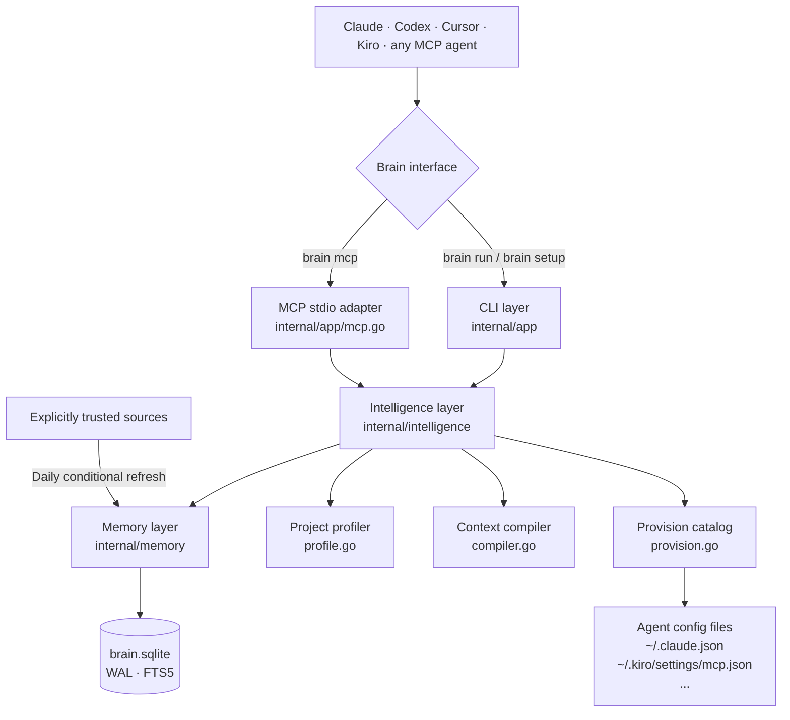

<p align="center">
  
</p>

# Noevyra

**Intelligence that evolves. One brain. Any agent.**

> **Your model is not the bottleneck. Rebuilding the same context is.**

Noevyra is a local-first thinking layer for coding agents. Run `brain setup` once in any project — it detects your stack, provisions the right skills and MCPs, and persists a profile your agents can share. Switch between Claude, Codex, Cursor, or Kiro and the brain travels with you.

> **Status: v0.3.0** · auto-project setup · persistent profiles · Kiro support · self-update  
> Single Go binary · SQLite FTS5 · MCP stdio · MIT

## The problem

Every new chat, agent switch, or compacted session starts cold. The agent rescans the repository, re-reads docs it already read, rebuilds decisions you already made, and burns tokens on context you already paid for.

| Pain | Brain's answer |
|---|---|
| Every session starts cold | Persists verified decisions and project profile in local SQLite |
| Giant prompts burn tokens | Ranks, deduplicates and truncates evidence to an explicit token budget |
| Stale docs and unclear provenance | Refreshes only explicitly trusted sources; keeps URL, hash and freshness metadata |
| Tool selection is guesswork | Matches project signals to skills/MCPs/CLIs and explains every recommendation |
| Context is locked inside one agent | Exposes the same brain to Claude, Codex, Cursor and Kiro through CLI and MCP |
| Setup repeats for every project | `brain setup` detects stack, provisions capabilities, stores the profile once |

## Install

**macOS / Linux** — one command, no Go or Node required:

```sh
curl -fsSL https://raw.githubusercontent.com/WolfCanCode/personal-ai-brain/main/install.sh | sh
export PATH="$HOME/.local/bin:$PATH"
brain init
```

**Windows PowerShell:**

```powershell
irm https://raw.githubusercontent.com/WolfCanCode/personal-ai-brain/main/install.ps1 | iex
$env:Path = "$HOME\.local\bin;$env:Path"
brain init
```

The installer downloads the matching release archive, verifies the SHA-256 checksum, and installs to `~/.local/bin`. No root required. → [Full install guide](docs/getting-started.md)

**Already installed? Update in one command:**

```sh
brain update          # install latest release
brain update --check  # just check, don't install
```

**Build from source** (requires Go ≥ 1.26):

```sh
go build -o build/brain ./cmd/brain
./build/brain init
```

## Quick start

```sh
# 1. Go to any project
cd ~/projects/my-api

# 2. Detect the stack, discover best-practice skills and MCPs, provision them
brain setup

# 3. Store a decision
brain remember "All API responses use camelCase" --type decision

# 4. Launch any agent with a ready-made context pack
brain run kiro "Add rate limiting to the payments endpoint"
brain run claude "Add rate limiting to the payments endpoint"
```

On the next session — or after switching from Claude to Kiro — the profile is already there. No re-setup.

## Commands

| Command | What it does |
|---|---|
| `brain init` | Create `~/.brain/brain.sqlite` |
| `brain init --schedule` | Register daily trusted-source refresh (macOS / Linux) |
| `brain setup` | Detect project, discover capabilities, provision, store profile |
| `brain setup --status` | Show stored profile for the current project |
| `brain setup --refresh` | Re-run detection and update the stored profile |
| `brain setup --dry-run` | Preview what would be detected and provisioned |
| `brain remember "…" --type decision` | Store a verified project memory |
| `brain remember "…" --scope personal` | Store a personal memory across all projects |
| `brain recall "query"` | Search verified memories |
| `brain context "task"` | Generate a simple context pack |
| `brain advise "task" --budget 1200` | Compile full intelligence pack (profile + memories + evidence + recommendations) |
| `brain feedback <pack-id> --outcome helpful` | Feed outcome back into knowledge ranking |
| `brain profile` | Detect and print project stack (read-only) |
| `brain run claude "task"` | Launch Claude with private context file |
| `brain run codex "task"` | Launch Codex with private context file |
| `brain run cursor "task"` | Launch Cursor with private context file |
| `brain run kiro "task"` | Launch Kiro with private context file |
| `brain sources add URL --name NAME` | Trust an external Markdown/text knowledge source |
| `brain sources seed` | Register the bundled Go, OWASP, and MCP primary-source catalog |
| `brain sources sync` | Pull registered sources with provenance and conditional requests |
| `brain sources list` | List registered sources |
| `brain skills find "react"` | Discover skills from skills.sh (requires npx) |
| `brain skills trust owner/repo@skill --keyword react` | Approve a reviewed skill |
| `brain skills list` | Show approved skills |
| `brain approve <id>` | Promote an agent-proposed memory candidate to verified |
| `brain sync --sources` | Local maintenance + refresh trusted sources |
| `brain sync --skills` | Local maintenance + explicit skill check |
| `brain digest --days 7` | Recent memories and events |
| `brain update` | Download and install the latest release |
| `brain update --check` | Report whether a newer release is available |
| `brain mcp` | Start MCP server over stdio |
| `brain mcp-config` | Print MCP server configuration JSON |
| `brain doctor` | Check prerequisites and stored profile status |
| `brain status` | Memory counts, scheduler status, knowledge items |

## MCP integration

Run `brain mcp-config` to get the JSON block for your client, then add it once:

```bash
# Claude
claude mcp add --scope user brain -- /path/to/brain mcp

# Kiro — paste brain mcp-config output into ~/.kiro/settings/mcp.json

# Cursor / Codex — use the JSON from brain mcp-config
```

**MCP tools available to agents:**

| Tool | Purpose |
|---|---|
| `brain_advise(task, budgetTokens?)` | Full intelligence pack — profile, memories, evidence, capability recommendations |
| `brain_profile()` | Project stack detection |
| `brain_context(task, limit?)` | Verified memories for a task |
| `brain_recall(query, limit?)` | Memory search |
| `brain_remember(content, type?)` | Propose a project memory for user review |
| `brain_feedback(packId, outcome, tokensUsed?)` | Record pack outcome for quality ranking |
| `brain_finish_task(summary, status, evidence?)` | Log task outcome |
| `brain_handoff(objective, completed?, remaining?)` | Record structured handoff between agents |

→ [Full MCP guide](docs/mcp.md)

## Architecture



→ [Architecture docs](docs/ARCHITECTURE.md)

## Security

- **User memories** — verified on write. **Agent memories** — candidate only; `brain approve` promotes them.
- **External sources** — bounded text, never executed. Kept as attributed evidence with URL, hash and staleness.
- **Skills** — never auto-installed. `brain skills trust` requires an explicit per-skill approval after your review.
- **Context files** — written with `0600` permissions, deleted when the agent process exits.
- **SQLite store** — `~/.brain` directory at `0700`, database at `0600`. Back up separately.

→ [Security reference](docs/security.md)

## Documentation

| Document | Contents |
|---|---|
| [Getting started](docs/getting-started.md) | Install, first use, daily workflow |
| [Commands](docs/commands.md) | Full reference with flags and examples |
| [Brain setup](docs/setup.md) | Auto-setup workflow, capability provisioning |
| [MCP integration](docs/mcp.md) | Connecting Claude, Codex, Cursor, Kiro |
| [Architecture](docs/ARCHITECTURE.md) | Components, trust model, data flow |
| [Security](docs/security.md) | Trust classes, boundaries, caveats |
| [Releasing](docs/RELEASING.md) | How releases and the bump workflow operate |
| [ADR 0001](docs/adr/0001-native-go-runtime.md) | Why Go |
| [ADR 0002](docs/adr/0002-intelligence-substrate.md) | Intelligence substrate design |
| [ADR 0003](docs/adr/0003-external-structural-intelligence.md) | External structural intelligence approach |

## Development

```sh
go test ./...          # all tests including property-based tests
go build ./cmd/brain   # build the binary
npm test               # JavaScript baseline
npm run check          # lint
```

## Roadmap

- [x] SQLite + FTS5 canonical memory store
- [x] MCP stdio tool gateway
- [x] CLI wrappers for Claude, Codex, Cursor, Kiro
- [x] Daily trusted-source refresh with provenance
- [x] Token-budgeted context compiler
- [x] Explainable skill / MCP / CLI recommendations
- [x] Context-pack feedback and bounded knowledge quality scoring
- [x] Auto-project setup — `brain setup` with persistent profiles
- [x] Capability provisioning with user approval
- [x] Self-update command — `brain update`
- [x] Automated bump-and-release CI workflow
- [ ] Curated primary-source feed catalog and source-specific extractors
- [ ] Benchmark recommendation precision and tokens per successful task
- [ ] Project identity handshake across MCP clients
- [ ] Session capture adapters and automatic outcome extraction
- [ ] Skill version pinning and validated upgrades
- [ ] Cross-device sync with single authoritative writer

Contributions welcome. See [`CONTRIBUTING.md`](CONTRIBUTING.md).

MIT © [WolfCanCode](https://github.com/WolfCanCode)
