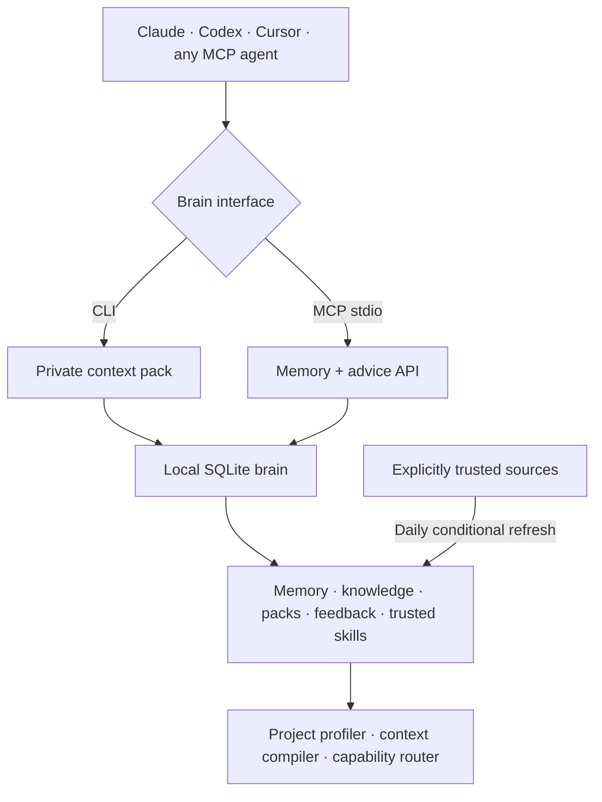

# 🧠 Personal AI Brain

**One brain. Any agent. Always learning.**

> **Your model is not the bottleneck. Rebuilding the same context is.**

Personal AI Brain is a local-first thinking layer for coding agents. It remembers reviewed decisions, understands the current project, pulls relevant best practices and hands any agent a compact, tool-aware starting point—without locking that knowledge inside one model or chat.

> **Status: v0.2.0 released** with deterministic project profiling, trusted-source retrieval, token-budgeted context compilation, explainable capability recommendations and feedback-weighted ranking. Current `main` adds an opted-in daily trusted-source refresh. Brain is not an autonomous agent and does not execute remote instructions.

## Why this exists

Coding agents are capable, but they repeatedly start **cold**. A new chat, a different agent, or a compacted session often means explaining the same architecture, decisions, constraints and preferred workflow again. The agent then rereads the repository, searches broad documentation, guesses which tools fit and consumes tokens rebuilding context you already paid for. **You should not have to pay—in time or tokens—for the same understanding twice.**

A normal task without Brain often looks like this:

1. Re-explain the project and paste old decisions.
2. Point the agent at several docs and hope they are still current.
3. Let each agent rediscover the stack, risks and useful tools independently.
4. Send a large prompt “just in case,” even though most of it is irrelevant.
5. Lose that work when you switch from Claude to Codex, Cursor, or a new session.

Brain moves that repeated preparation into one local, inspectable layer. It profiles the current project, recalls verified decisions, retrieves relevant fragments from sources you chose, and returns a compact plan with risks, verification gates and explainable skill/MCP/CLI suggestions. Any agent can consume the same pack through the CLI or MCP.

| Everyday pain | What Brain does | Practical result |
| --- | --- | --- |
| Every session starts without project history | Keeps verified personal and project memory in local SQLite | Less re-explaining and fewer contradictory decisions |
| Agents reread too much or receive giant prompts | Ranks, deduplicates and truncates evidence to an explicit token budget | Smaller prompts with the useful context first |
| Best-practice advice becomes stale or has unclear provenance | Refreshes only explicitly trusted sources and keeps URL, hash and freshness metadata | Advice is attributable, reviewable and cheaper to refresh |
| Choosing a skill, MCP or CLI is guesswork | Matches project/task signals and explains every recommendation | Less tool hunting; no silent installs or trust changes |
| Useful context is trapped inside one vendor or chat | Exposes the same brain through a native CLI and stdio MCP | Switch agents without rebuilding the thinking layer |
| Feedback disappears after the task | Records pack outcomes and adjusts bounded retrieval weights | The next pack can spend its token budget more effectively |

For example, asking an agent to “secure the payment webhook” normally triggers another repository scan and another long explanation. With Brain, `brain advise "secure the payment webhook" --budget 512` can hand the agent the detected stack, relevant decisions, attributed security evidence, likely failure modes, verification steps and the tools that fit—all inside a reviewable budget. Brain does not replace the agent; it gives the agent a better starting point.

## Quick start

### Native Go preview

The native implementation ships as a single executable for memory, SQLite FTS5 and MCP. It shares the existing JavaScript database and does not require Node for these operations. JavaScript remains supported while compatibility is verified.

Install the latest tested macOS or Linux release without Go or Node:

```sh
curl -fsSL https://raw.githubusercontent.com/WolfCanCode/personal-ai-brain/main/install.sh | sh
export PATH="$HOME/.local/bin:$PATH"
brain init
```

The installer detects OS/architecture, downloads the matching GitHub Release archive, verifies it against the published `SHA256SUMS`, and installs to `~/.local/bin` without `sudo`. Pin a release with `BRAIN_VERSION=v0.2.0`, or choose a destination with `BRAIN_INSTALL_DIR=/path/to/bin`. On Windows PowerShell:

```powershell
irm https://raw.githubusercontent.com/WolfCanCode/personal-ai-brain/main/install.ps1 | iex
$env:Path = "$HOME\.local\bin;$env:Path"
brain init
```

Review a remote installer before piping it to a shell when your threat model requires it. Checksums protect the downloaded archive from corruption or mismatch; they are not code-signing signatures.

Build from source instead:

```sh
go build -o build/brain ./cmd/brain
./build/brain init
./build/brain remember "Payment webhooks require idempotency" --type decision
./build/brain recall payment
./build/brain profile
./build/brain advise "implement a secure payment webhook" --budget 1200
./build/brain sources seed   # register a reviewable primary-source starter catalog
./build/brain sources sync   # initial explicit pull
./build/brain mcp-config
# Optional: refresh those trusted sources daily, using a permanent binary path.
./build/brain init --schedule
```

Building requires Go >= 1.26; installing a release binary does not. CI pins its toolchain and tests native binaries on five OS/architecture combinations. Downloads are available as development artifacts on successful CI runs; tagged releases publish archives, SHA-256 checksums and automatically generated release notes. See [release instructions](docs/RELEASING.md) and [runtime decision](docs/adr/0001-native-go-runtime.md).

Native `init` only creates the store; `--schedule` is required to register a timer. The timer runs `brain sync --sources`: local maintenance plus network refresh of sources you explicitly registered, without executing `npx` or third-party skill tooling. `brain sync --skills`, the compatibility alias `brain sync --online`, and skills commands require Node and may execute third-party code. Windows scheduling remains manual and file privacy depends on user ACLs.

Native MCP configuration uses the absolute binary path with `args: ["mcp"]`; start it in the intended project's working directory. No performance superiority over Node or Rust is claimed without measurements.

### JavaScript CLI (existing MVP)

Requirements: Node.js >= 22.13 (we recommend 22.20+ for `skills` CLI), macOS or Linux. Windows is usable manually but scheduled setup is not yet implemented.

```bash
git clone https://github.com/WolfCanCode/personal-ai-brain.git
cd personal-ai-brain
npm link
brain init
cd /your/project
brain remember "We require idempotency for payment webhooks" --type decision
brain recall "payment"
brain run claude "Implement payment webhook"
```

`npm link` installs the `brain` executable on your machine; the package does not depend on any cloud service or LLM provider. The CLI uses `node:sqlite` and `fts5` built into Node 22; Node 22 may print an experimental warning when opening SQLite. No dependencies or Docker required.

## Commands

| Command | Function |
| --- | --- |
| `brain init` | Create `~/.brain/brain.sqlite` |
| `brain init --schedule` | Install daily local maintenance and trusted-source refresh |
| `brain remember "..." --type decision` | Store a user-approved project memory |
| `brain remember "..." --scope personal` | Store personal memory available to any project |
| `brain recall "payment"` | Search relevant verified memory |
| `brain context "build payment API"` | Generate task context pack |
| `brain profile` | Detect languages, stacks and operational signals from bounded project evidence |
| `brain advise "task" --budget 1200` | Compile memories, external knowledge and capability recommendations to a token budget |
| `brain feedback <pack-id> --outcome helpful` | Feed a pack outcome back into bounded knowledge ranking |
| `brain sources add URL --name NAME --tags ...` | Explicitly trust a text/Markdown knowledge source |
| `brain sources seed` | Register the bundled Go, OWASP and MCP primary-source starter catalog |
| `brain sources sync` | Pull registered sources with provenance, limits and conditional requests |
| `brain approve <id>` | Promote an agent-proposed candidate to verified |
| `brain run claude "task"` | Launch Claude CLI with private context file |
| `brain run codex "task"` | Launch Codex CLI with the same brain |
| `brain run cursor "task"` | Launch `cursor-agent` with the same brain |
| `brain skills find "react"` | Find skills from skills.sh (network / npx required) |
| `brain skills trust owner/repo@skill --keyword react` | Approve a reviewed skill for matching tasks |
| `brain skills list` | Show approved skills |
| `brain sync --sources` | Local maintenance plus refresh of explicitly trusted sources |
| `brain sync --skills` | Local maintenance plus an explicit `npx skills check` |
| `brain sync --online` | Compatibility alias that runs both online operations |
| `brain digest --days 7` | Recent memories and events |
| `brain mcp` | Start MCP server over stdio |
| `brain mcp-config` | Print MCP server configuration JSON |
| `brain doctor` | Local dependency diagnostics |

## Connect the MCP gateway

Connect once per client (replace paths according to your installation):

```bash
claude mcp add --scope user brain -- node /ABS/PATH/personal-ai-brain/bin/brain.mjs mcp
codex mcp add brain -- node /ABS/PATH/personal-ai-brain/bin/brain.mjs mcp
brain mcp-config  # use JSON for Cursor's MCP config
```

**Project identity:** The MCP server uses its working directory's Git root to scope project memories. Ensure the client starts the Brain MCP process in the same workspace when relying on project memory. A cross-project project-ID handshake is planned.

### MCP tools

- `brain_context(task, limit?)` — verified context pack for a task.
- `brain_advise(task, budgetTokens?)` — full token-budgeted intelligence pack with project profile and capability recommendations.
- `brain_profile()` — bounded stack and project-signal detection.
- `brain_feedback(packId, outcome, tokensUsed?, notes?)` — outcome signal for future knowledge ranking.
- `brain_recall(query, limit?)` — verified scoped memory search.
- `brain_remember(content, type?)` — create a **project-scoped candidate** for review.
- `brain_finish_task(summary, status, evidence?)` — store a task outcome event.
- `brain_handoff(objective, completed?, remaining?, evidence?)` — record handoff metadata.

MCP server speaks newline-delimited JSON-RPC over stdio, with no `console.log` on stdout outside protocol. This implementation deliberately supports a small subset of MCP methods; validate with your actual MCP host before depending on interoperability.

## Skills workflow

```bash
brain skills find "typescript"
# Review the contents, scripts, and source of the selected skill yourself.
brain skills trust vercel-labs/agent-skills@web-design-guidelines --keyword design
brain run claude "design a new product landing page"
```

The wrapper matches trusted skills by case-insensitive keyword and loads their prompt via `npx skills use`. **Untrusted skills are never auto-installed or silently trusted.** Skill loading depends on the current version of the external `skills` CLI; network access may be necessary. The initial MVP does **not** auto-recommend or install a newly discovered skill when no trusted match exists. `brain skills find` is an explicit discovery command.

## Daily updates

After registering the sources you trust, `brain init --schedule` registers a daily job at **08:00 local time**:

- macOS: user `launchd` LaunchAgent
- Linux: user `systemd` timer with `Persistent=true` (missed runs are recovered)
- Windows: manual `brain sync --sources` for now

The job expires memories with elapsed `expires_at`, records a digest event, and conditionally fetches only explicitly registered HTTPS sources. Conditional requests avoid downloading unchanged documents. Remote content stays inert, attributed evidence; it cannot rewrite memory, install skills, run commands or train a model. Skill checking remains a separate explicit `brain sync --skills` action. It does not yet recover missed runs on macOS beyond the scheduler's normal behavior.

## Architecture



GitHub contains **public application source**, not private memories. Do not add local databases, secrets, context packs or API keys to commits. The `.gitignore` covers standard local files; still review changes before committing.

## Security and caveats

- User-origin CLI memories are verified; agent-origin memories require explicit approval.
- Memory should be treated as untrusted reference, never as higher-priority instructions.
- Scope checks cover project or personal memory, but this is a single-user local tool, not a multi-tenant authorization boundary.
- Skill trust does not sandbox its scripts: only trust and use skills after reviewing them.
- Agent launch wrapper creates a `0600` temporary context file and removes it when the child process exits.
- Private SQLite data lives in `~/.brain` (directory `0700`, database `0600`). Backups must be protected separately.
- No embeddings, semantic vector search, conflict reconciliation or cross-device sync. The v0.2 compiler establishes a measurable lexical baseline first.
- External source content is inert, untrusted evidence. It is bounded, hashed and attributed; it is never executed or promoted to an instruction.
- Agent CLI invocation and MCP compatibility should be tested against your installed versions; `brain run` is a basic wrapper, not a transparent full agent harness.

## Development

```bash
npm test
npm run check
node bin/brain.mjs help
```

Landing page: [`site/index.html`](site/index.html), deploy as a static site. No backend or access to personal memory.

## Roadmap

- [x] SQLite + FTS5 canonical memory store
- [x] Scoped recall, manual review, basic context packs
- [x] MCP stdio tool gateway
- [x] CLI wrapper for installed agents
- [x] Daily maintenance for macOS/Linux
- [x] skills.sh find + manually approved skill use
- [x] Deterministic project profiler and token-budgeted context compiler
- [x] Explainable skill/MCP/CLI recommendations without auto-installation
- [x] Explicitly trusted source sync with provenance and prompt-injection boundaries
- [x] Context-pack feedback and bounded knowledge quality scoring
- [x] Daily conditional refresh of explicitly trusted best-practice sources
- [ ] Curated primary-source feed catalog and source-specific extractors
- [ ] Benchmark recommendation precision and tokens per successful task
- [ ] Session capture adapters and automatic outcome extraction
- [ ] Project identity handshake across MCP clients
- [ ] Skill version pinning and validated upgrades
- [ ] Cross-device sync with single authoritative writer
- [ ] Context quality benchmarks and self-improvement evaluation

Contributions welcome. See [`CONTRIBUTING.md`](CONTRIBUTING.md).

MIT © [WolfCanCode](https://github.com/WolfCanCode)
