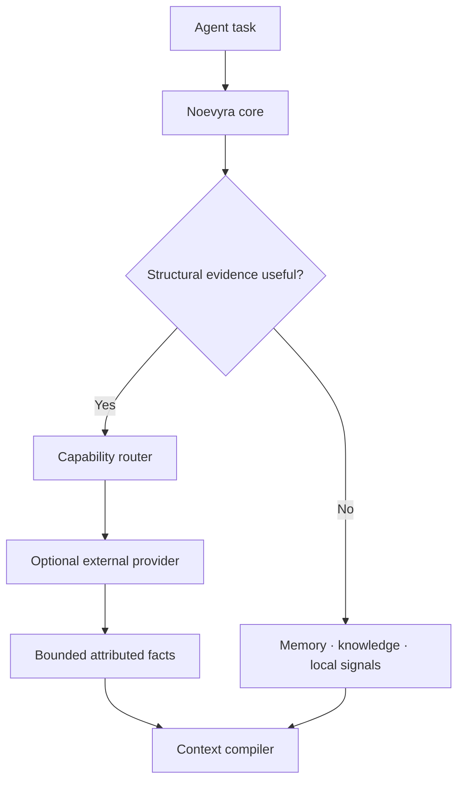

# ADR 0003: Structural intelligence stays outside the core

- Status: accepted
- Date: 2026-10-21

## Context

Large refactors and impact-analysis tasks can benefit from symbol, call and dependency graphs. Building that capability inside Noevyra would also make the core responsible for language parsers, incremental indexing, stale-index detection and graph storage. Those responsibilities already have specialist implementations and would compete with Noevyra's purpose: selecting and compiling the smallest useful set of memory, trusted knowledge, project signals and tools for the task at hand.

Most tasks do not require a persistent graph. The existing bounded profiler plus the agent's normal Git, search and language tooling is sufficient for small edits. A graph is valuable only when its additional structural evidence improves an outcome enough to justify its latency, maintenance and context cost.

## Decision

Code graphs are optional **capability providers**, not a Noevyra core subsystem or required dependency.

Noevyra owns task detection, provider selection, execution policy, budgets, output validation, evidence normalization and usefulness feedback. A provider owns repository indexing, language-specific analysis, traversal and freshness. Noevyra must remain fully functional when no structural provider is configured or when a provider fails.

The first provider milestone is registry-only: a versioned manifest, validation, explicit trust state and explainable recommendations. It does **not** execute providers. Later CLI or MCP adapters require a separate decision and tests for timeouts, output limits, provenance, project revision, fallback behavior and command-injection resistance. Remote automatic execution is out of scope.

## Provider boundary

| Noevyra owns | Provider owns |
| --- | --- |
| Detecting whether structural evidence is useful | Parsing and indexing repositories |
| Selecting a trusted provider and execution policy | Symbol, call and dependency analysis |
| Time, output and context-token budgets | Language-specific accuracy |
| Validating and normalizing attributed facts | Traversal and index freshness |
| Combining facts with memory and trusted sources | Provider release and storage lifecycle |
| Measuring task-level usefulness | Provider-specific diagnostics |

Provider output is untrusted evidence, never instruction text. It cannot create verified memory, alter trust state, install software or bypass normal user/client approval. Raw graphs are not added to context packs; only relevant, deduplicated facts may receive a capped share of the evidence budget.

## Consequences and exit criteria

This keeps the binary and data model small and avoids duplicating mature code-intelligence work. It also means Noevyra cannot promise graph-powered impact analysis without a compatible provider.

A provider execution adapter should be retained only if benchmarks show a useful improvement on representative cross-module tasks without regressing ordinary-task latency or breaking no-provider behavior. Provider failure must degrade to local intelligence, not fail `brain advise`.

## References

- [Model Context Protocol architecture](https://modelcontextprotocol.io/docs/learn/architecture)
- [Model Context Protocol security best practices](https://modelcontextprotocol.io/specification/2025-06-18/basic/security_best_practices)
- [Go `os/exec` package](https://pkg.go.dev/os/exec) — executes commands without invoking a shell by default
- [JSON Schema specification](https://json-schema.org/specification)

